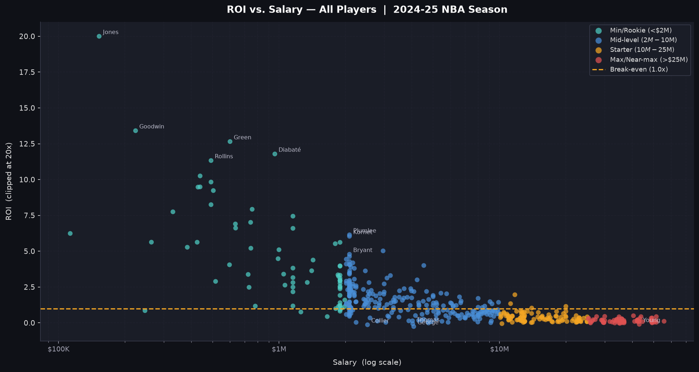
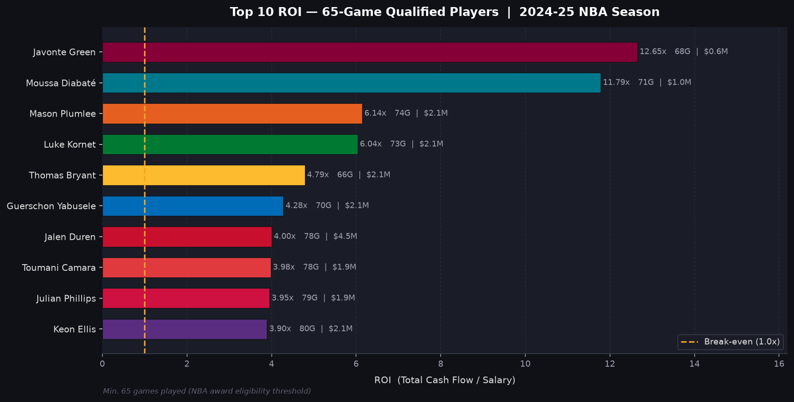
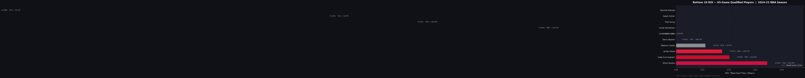
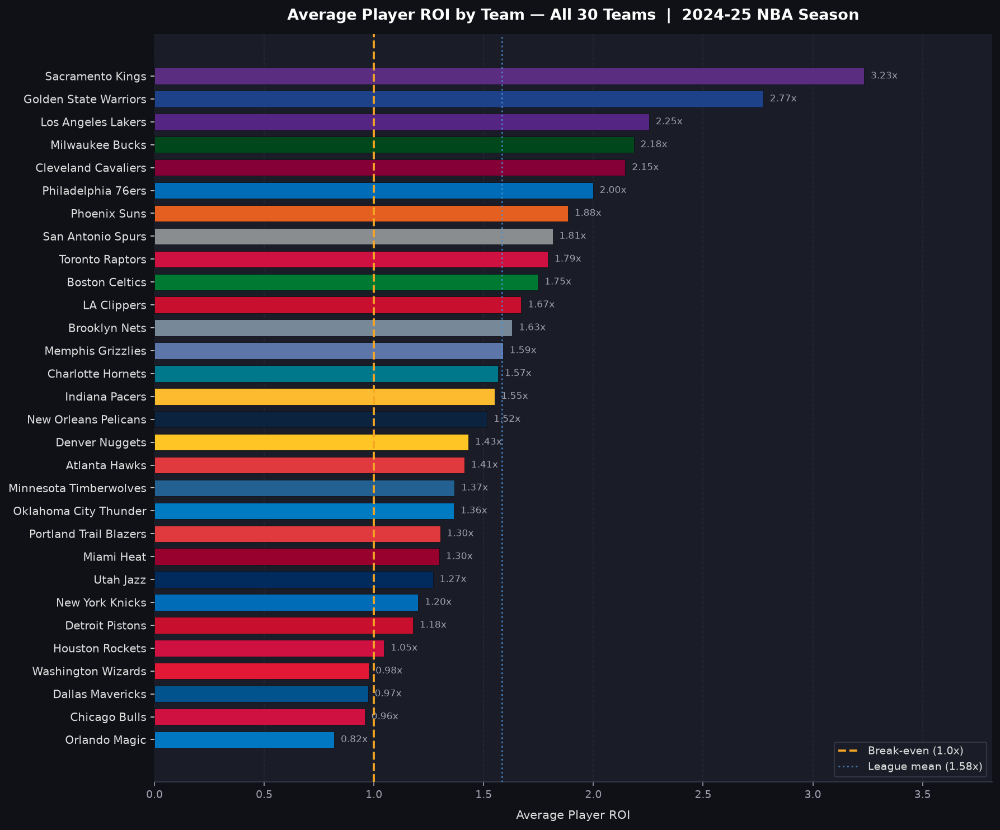
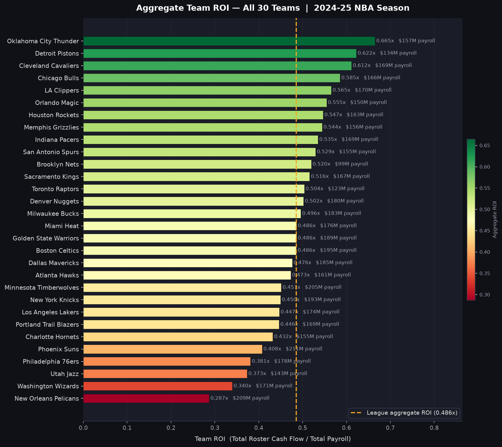
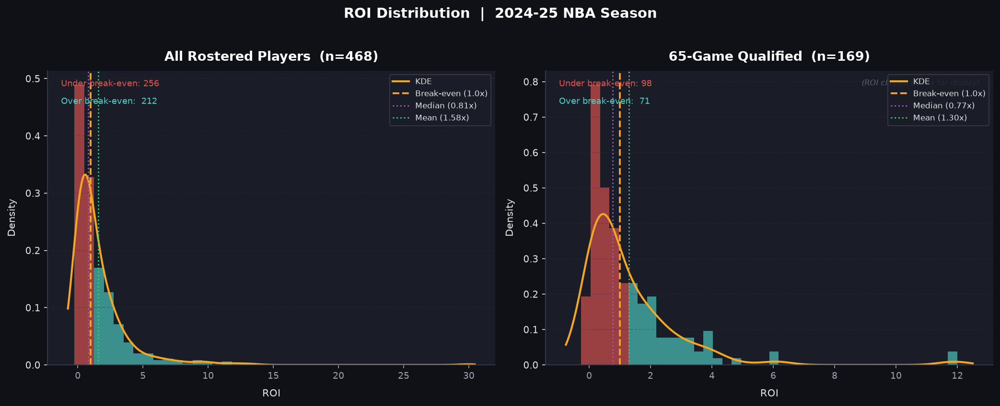
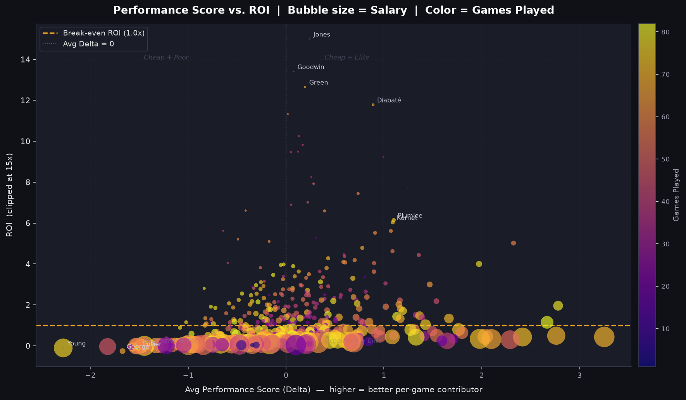
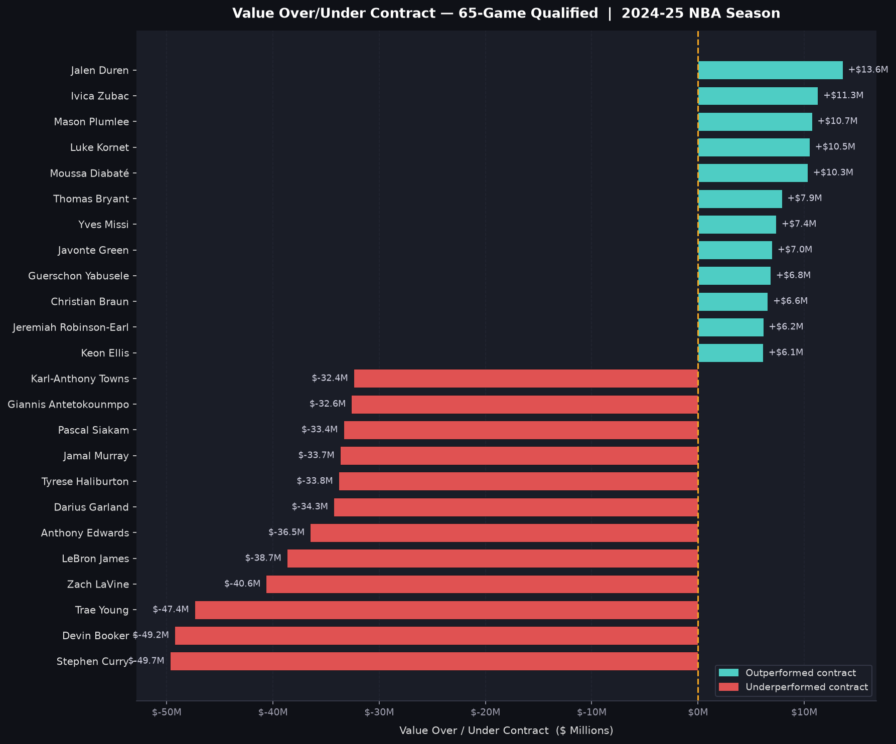
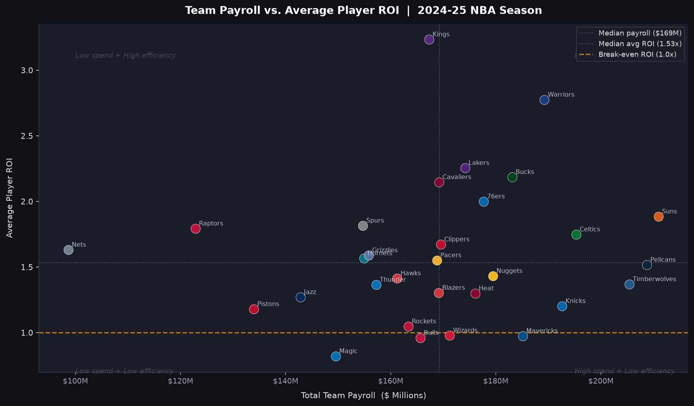

# NBA Player ROI Analysis (2024-25)

**Which NBA players return the most on-court value for what they're paid?**

This project puts a dollar value on every game each NBA player played in the 2024-25 regular season, adds those values up over the season, and compares the total to the player's salary. A ROI of 1.0x means the player produced exactly what he was paid. Above 1.0x he was a bargain; below 1.0x he was overpaid.

The method adapts the ROI framework of [Lautier (2025)](https://doi.org/10.1002/asmb.70020) to the 2024-25 season. Salaries are scraped from ESPN, and 24 box-score and player-tracking stats come from the NBA Stats API.

📄 **Full write-up:** [*Evaluating NBA Contract Efficiency Through Performance-Based Value and Return on Investment Framework*](docs/NBA_ROI_Research_Paper.pdf) (Gavin Nelson, DS-410 Seminar in Data Science, April 2026)



---

## Key findings

*468 players with a matched 2024-25 salary. "Qualified" means 65 or more games played (169 players).*

- **Cheap contracts dominate the ROI rankings.** ROI falls steadily as salary rises (Spearman ρ = −0.81). The average ROI is **2.78x** for minimum contracts (under $5M), **0.69x** for mid-level ($5–15M), **0.26x** for starter ($15–35M) and **0.14x** for supermax deals (over $35M). Only one player earning more than $15M reached break-even.
- **The best-value qualified players were rotation bigs on minimum-level deals:** Javonte Green (12.7x), Moussa Diabaté (11.8x), Mason Plumlee (6.1x), Luke Kornet (6.0x) and Thomas Bryant (4.8x). Measured as dollars of value over contract, the leaders were Jalen Duren (+$13.6M), Walker Kessler (+$11.9M) and Ivica Zubac (+$11.3M).
- **Guard-heavy, high-usage players scored lowest.** Keyonte George (−0.26x), Isaiah Collier, Trae Young, Scoot Henderson and Anfernee Simons produced negative performance scores, mostly because missed shots and turnovers carry large negative weights. Assists are not one of the 24 variables, so playmaking earns little credit.
- **The model rewards centers.** Rebounds (four separate rebound variables) and defended shots weigh heavily, so the highest total cash flows went to Zubac, Jarrett Allen, Nikola Jokić and Domantas Sabonis. Lautier et al. report the same tilt toward centers.
- **Teams:** Sacramento had the highest average player ROI (3.23x) and Orlando the lowest (0.82x). On aggregate payroll ROI, Oklahoma City led (0.665x) and New Orleans trailed (0.287x).
- League-wide: mean ROI 1.58x, median 0.81x, with 212 players above 1.0x and 256 below. *See [Known limitations](#known-limitations) for how to read the 1.0x line.*

| Best value (65+ games) | Worst value (65+ games) |
|---|---|
|  |  |

<details>
<summary>More charts</summary>

| | |
|---|---|
|  |  |
|  |  |
|  |  |

All 16 charts are in [`outputs/figures/`](outputs/figures/).
</details>

---

## Methodology

The model follows the Lautier et al. variable list and coefficients. It replaces their logistic win-probability model and IRR solve with a **linear performance score** and a **simple cash-flow ratio**, so it measures what actually happened rather than modelling the probability of winning.

| Step | Formula | What it means |
|---|---|---|
| 1. Performance score | Δ<sub>gm</sub> = Σ<sub>j</sub> β<sub>j</sub> (x<sub>gm,j</sub> − x̄<sub>j</sub>) | Weighted sum of player *m*'s centered stats in game *g*. An exactly average game scores 0. |
| 2. Merit share (WRMS) | WRMS<sub>gm</sub> = ((Δ<sub>gm</sub> − Δ̄) / SD(Δ)) · (1/m̄) + 1/m̄ | Standardizes Δ into a share of that game's value. Average = 1/m̄ (≈ 4.68%, with m̄ ≈ 21.4 players per game). |
| 3. Single game value | SGV = total salary pool / (30 teams × 82 games) | A uniform dollar value per game: $5.17B / 2,460 = **$2.10M**. |
| 4. Cash flow | CF<sub>gm</sub> = SGV · WRMS<sub>gm</sub> | Dollar value of each game. Bad games can be negative, and missed games contribute $0. |
| 5. ROI | ROI = Σ<sub>g</sub> CF<sub>gm</sub> / salary | Season value generated per dollar of salary. |

Because missed games add $0, **availability is penalized directly**, so no minimum-games filter is needed.

**The 24 weights (β)** come from Table 1 of Lautier et al.:
- **Positive:** made shots (FG2O, FG3O, FTMO), uncontested and contested rebounds (AORB, ADRB, OCRB, DCRB), STL, BLK, fouls drawn (PFD), charges drawn (CHGD), screen assists (SAST), 2-pt contests (AC2P), box-outs (DBOX), defended misses (DFGX) and non-assist passes (APM).
- **Negative:** misses (FG2X, FG3X, FTMX), PF, TOV, 3-pt contests (C3P), defended makes (DFGO) and defensive distance (DDIS).

The full table is in [`src/nba_roi/config.py`](src/nba_roi/config.py). Box-score stats are used game by game. Tracking stats are only published as season averages, so each player's season average is applied to every game he played.

### Known limitations

These come from the original analysis and are **left unchanged** here, so the published results stay reproducible:

1. **The break-even line is scaled by ½.** SGV is the salary pool divided by *team*-games (2,460). The WRMS shares, however, sum to 1 per *game* across both teams (1,230 games). As a result, the cash flows add up to exactly half the salary pool ($2.58B of $5.17B), and league-wide aggregate ROI is about 0.49x rather than 1.0x. The player and team **rankings are unaffected**. Absolute ROI values, the 212/256 split around 1.0x, and the "value over contract" dollar figures would all change if SGV were defined per game (pool ÷ 1,230), which is how Lautier et al. define it.
2. **Fouls drawn (PFD) has no effect.** The NBA game-log endpoint has no PFD column, so it is set to 0 in every game, and its weight (0.214) drops out. Season-average PFD is available and could be attached like the other tracking stats.
3. **101 players without a salary match are excluded.** These are mostly two-way, G-League and waived players whose names don't appear on ESPN's salary pages.
4. **Teams come from the salary table.** A player traded mid-season is listed under his ESPN team, while his value covers all of his games.
5. **One regular season only:** no playoffs and no multi-year contract view. Also, 100 game rows with 0 minutes are counted as games played.

---

## Repository structure

```
nba-roi-analysis/
├── src/nba_roi/              # Reusable package
│   ├── config.py             #   season, file paths, model weights
│   ├── scrape_salaries.py    #   ESPN salary scraper
│   ├── collect_stats.py      #   NBA Stats API collection
│   ├── cleaning.py           #   name matching, salary parsing, shooting splits
│   └── roi.py                #   Delta → WRMS → SGV → CF → ROI, Excel output
├── scripts/
│   ├── fetch_data.py         # download raw data  → data/raw/
│   └── run_roi.py            # compute ROI        → data/processed/
├── notebooks/                # step-by-step walkthroughs and charts
│   ├── 01_scrape_salaries.ipynb
│   ├── 02_collect_player_stats.ipynb
│   ├── 03_roi_calculator.ipynb
│   ├── 04_visualizations.ipynb
│   └── 05_quick_charts.ipynb
├── tests/test_roi.py         # unit tests for every formula + regression check
├── outputs/figures/          # charts used in this README
├── docs/                     # research paper (PDF)
├── data/raw/, data/processed/  # created locally; not committed
├── requirements.txt
└── pyproject.toml
```

---

## Setup

Requires Python 3.10+ (developed on 3.13).

```bash
git clone https://github.com/Gavin-D-Nelson/nba-roi-analysis.git
cd nba-roi-analysis
python -m venv .venv
source .venv/bin/activate        # Windows: .venv\Scripts\activate
pip install -r requirements.txt  # also installs src/nba_roi as a package
```

No API keys are needed: both the NBA Stats API and ESPN's salary pages are public.

## Running the pipeline

```bash
python scripts/fetch_data.py   # 1. download salaries + stats (~10 min) → data/raw/
python scripts/run_roi.py      # 2. compute ROI (~15 s) → data/processed/player_roi_2024-25.xlsx
jupyter lab notebooks/04_visualizations.ipynb   # 3. rebuild the charts → outputs/figures/
```

The ROI workbook has four sheets: **ROI Results** (one row per player), **Model Parameters**, **Performance Weights**, and **Game Logs + WRMS** (every player-game with Δ, WRMS and cash flow).

To see each calculation step with intermediate output, open `notebooks/03_roi_calculator.ipynb`.

## Data sources and refreshing

| Data | Source | How it's collected |
|---|---|---|
| Salaries | [ESPN NBA salaries](https://www.espn.com/nba/salaries) (13 pages) | `requests` + BeautifulSoup |
| Game logs (26,306 player-games) | NBA Stats API `PlayerGameLog` | [`nba_api`](https://github.com/swar/nba_api) |
| Tracking stats (rebounding, defense, hustle, passing, speed/distance) | NBA Stats API `LeagueDashPtStats`, `LeagueDashPtDefend`, `LeagueHustleStatsPlayer` | `nba_api` |

The data files are **not committed** to this repository. Run `scripts/fetch_data.py` to download them. The results above come from a snapshot taken right after the 2024-25 regular season ended (April 2025). ESPN's salary pages change as contracts change, so a fresh download may give slightly different numbers.

**Another season:** change `SEASON`, `ESPN_SALARY_YEAR` and, if needed, `ESPN_SALARY_PAGES` in `src/nba_roi/config.py`, then rerun both scripts. The model weights stay the same.

## Tests

```bash
pytest
```

The tests check each formula on hand-computed examples: centering, WRMS mean and SD equal to 1/m̄, SGV, ROI, missed games, name matching, salary parsing and the scraper's row parsing. They also run the full pipeline on synthetic data. When the raw data is present, a regression test confirms the published 2024-25 numbers are reproduced.

## Contributing notes

Notebooks are committed without outputs. To strip outputs automatically on every commit:

```bash
nbstripout --install
```

## References

- Lautier, J. P. (2025). A new framework to estimate return on investment for player salaries in the National Basketball Association. *Applied Stochastic Models in Business and Industry*, 41(3), e70020. [doi:10.1002/asmb.70020](https://doi.org/10.1002/asmb.70020). Replication code: [github.com/jackson-lautier/nba_roi](https://github.com/jackson-lautier/nba_roi).
- The full reference list is in the [paper](docs/NBA_ROI_Research_Paper.pdf).
- [`nba_api`](https://github.com/swar/nba_api): Python client for the NBA Stats API.

## Questions and feedback

If you have a question, spot a bug or want to suggest an improvement, please [open an issue](https://github.com/Gavin-D-Nelson/nba-roi-analysis/issues) or reach out through my GitHub profile, [@Gavin-D-Nelson](https://github.com/Gavin-D-Nelson).

## License

Code is released under the [MIT License](LICENSE). NBA and ESPN data remain subject to their owners' terms of use.
